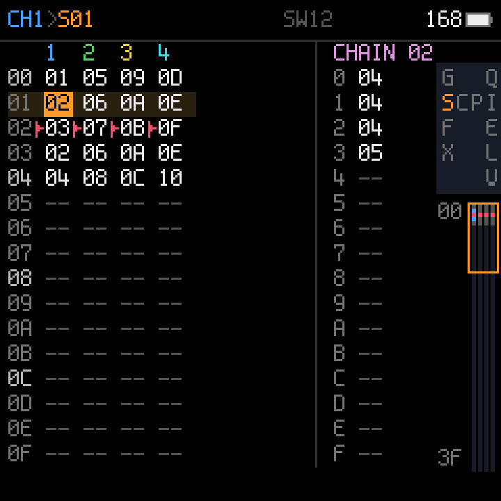
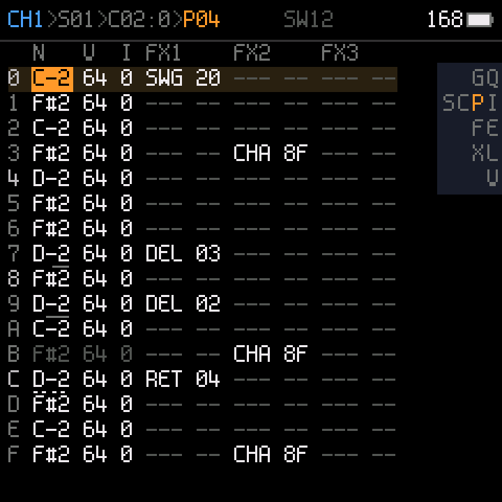

# Ketch

**A tracker firmware for the M-VAVE FM-1**, in the LSDJ / picoTracker / M8 line: song, chain and phrase screens,
instruments, effects and a mixer, on the FM-1's own keys and screen.

**[Try it in your browser or install it on your FM-1](https://risseraka.github.io/fm1-tracker-ketch/)** ·
**[Every screen and the controls](https://risseraka.github.io/fm1-tracker-ketch/guide/)**

 

> **Status: 0.1 beta.** It runs on the FM-1, but it has been tested on one unit by one person. Expect bugs, and
> expect that a song saved in a beta may not load in the next one. To keep a song, record it over USB audio.

**M-Vave SMK-37:** see [SMK-37 instructions](SMK37.md).

## What it does

- **4 channels**, each playing one of Felucca's sound engines (FM, physical models, drums, grains, ...).
- **Song → chain → phrase**, as in LSDJ: the song lists chains per channel, a chain lists phrases, a phrase is
  16 rows of note, instrument, velocity and commands.
- **Commands** on each row: delay, retrigger, ramps, chance, hops, swing, and every sound parameter of the
  instrument.
- **Instrument pages** (engine, preset, envelope, LFO, voice and sends) and 4 knob slots per instrument.
- **Effects** (delay, reverb, chorus) and a **mixer** (level, mute, solo per channel).
- **Live recording** from the keybed with count-in and metronome, and step entry.
- **Projects** saved in the FM-1's flash.
- USB-MIDI, and USB audio: the FM-1 shows up as an audio input you can record.

## Install

1. Charge the FM-1 fully and keep it on USB power.
2. Download `ketch-X.Y.fwsc` from [Releases](../../releases).
3. Install it from the command line (once: `pip3 install mido python-rtmidi`):
   `python3 tools/fm1_install.py ketch-X.Y.fwsc`. It asks before it writes.
4. Do not touch the FM-1 or the cable until it restarts.

**Back to the official firmware or another one:** the [FM-1 Firmware Hub](https://fm1.designburgapps.com) in
Chrome or Edge. Ketch answers the hub's updater like every firmware there.

**If an install is cut off:** hold **OCT-** while switching on: the FM-1 starts in update mode (three LED
flashes) and the installer finishes the job.

**Installing firmware is at your own risk.** A power loss in the first seconds of a write can leave an FM-1 dark;
it then needs a recovery dongle ([MvaveFM1Unbricker](https://github.com/Quixotic7/MvaveFM1Unbricker)).

## Build

Linux on x86-64, or macOS / Windows with Docker; Python 3 with Pillow; the JieLi toolchain and three files of the
JieLi AC79 SDK:

```sh
pip3 install Pillow
tools/get_toolchain.sh                      # JieLi's clang for the chip, to ~/.jieli/toolchain
git clone --depth 1 --branch AC79NN_SDK_V1.2.1_2023-12-13 \
    https://gitee.com/Jieli-Tech/fw-AC79_AIoT_SDK.git ~/fw-AC79_AIoT_SDK
./build.sh --release 0.1                    # -> build/ketch-0.1.fwsc, identity FM-1_951
```

On Windows (PowerShell, Docker Desktop running), point the build at your copies and call it directly:

```powershell
$env:JIELI_TOOLCHAIN = "<toolchain>"; $env:AC79_SDK = "<sdk>"; $env:JIELI_DOCKER = "1"; python tools/build.py --release 0.1
```

For the M-Vave SMK-37: `BOARD=smk37 ./build.sh` (`MODEL=elite` / `mke` for those models; [SMK37.md](SMK37.md)).

`tests/run_host.sh` runs the firmware on your computer (screens as images, the sound as a WAV). The platform's
API and rules: [docs/API.md](docs/API.md), [docs/RULES.md](docs/RULES.md). Development notes:
[CHECKLIST.md](CHECKLIST.md).

## Credits and license

GPL-3.0-only. Ketch is built on [Dinghy](https://github.com/zvenson/dinghy) (zvenson), the platform of
[Felucca](https://github.com/hugelton/Felucca) by Leo Kuroshita (Hügelton Instruments) as
[SLOOP](https://github.com/isod89/sloop-fm1) (isod89) carries it, and Felucca's sound layer. Details and
third-party parts in [LICENSING.md](LICENSING.md).
